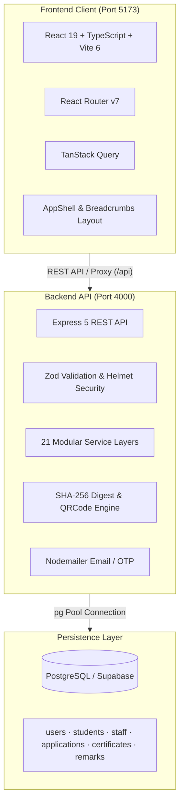
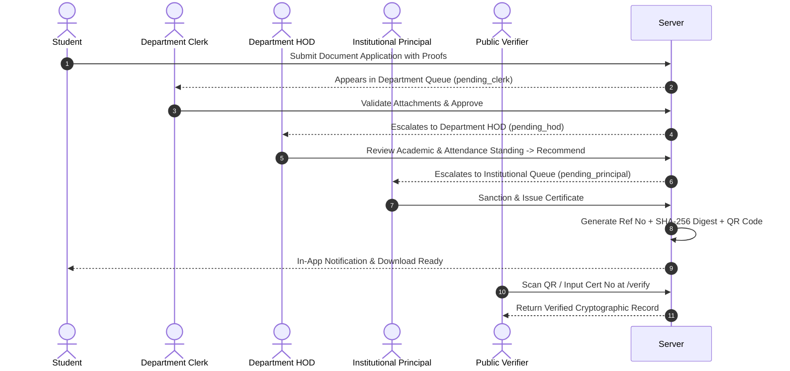

# 🏛️ JDCOEM Digital Document Services Portal (V2)

[](https://react.dev/)
[](https://www.typescriptlang.org/)
[](https://vitejs.dev/)
[](https://expressjs.com/)
[](https://supabase.com/)
[](https://jdcoem.ac.in)

> An enterprise-grade institutional document issuance, verification, and student lifecycle management portal built for **JD College of Engineering and Management (JDCOEM), Nagpur** (An Autonomous Institute affiliated to DBATU, RTMNU & MSBTE, NAAC Accredited).

---

## 🌟 Key Highlights

- **Multi-Tier Hierarchical Approval Workflow**: Strictly isolates review stages across **Academic Clerk** (Department-level) $\rightarrow$ **HOD** (Department-level) $\rightarrow$ **Principal** (Institutional Sanction).
- **13+ Official Document Types**: Covers academic and conduct documents (Bonafide, Admission Letter, College ID, Fee Structure, Hall Ticket, Mark Sheets, Provisional, Degree, TC, Migration, Character, NOC, Transcripts).
- **Cryptographic Document Signing**: Each issued document embeds a verifiable **SHA-256 digital digest** and a **dynamic vector QR code**.
- **Public Third-Party Verification (`/verify`)**: Direct public verification portal for employers, universities, and visa authorities to validate document authenticity without requiring an account.
- **Smart Dynamic Document Forms**: Conditional multi-document file uploads (up to 10MB), purpose auto-templates (Bank Loan, Passport, Scholarship, Internship, etc.), and student declarations.
- **Clean Single `.env` Architecture**: Streamlined configuration located inside `backend/.env` with safe, zero-secret example templates.

---

## 🏗️ Architecture & Technology Stack



### Stack Breakdown

- **Frontend**:
  - **Framework**: React 19 (`react`, `react-dom`) with TypeScript 5.8
  - **Build & Dev Tool**: Vite 6 with proxying to backend on port 4000
  - **Routing**: React Router v7 (`react-router-dom`)
  - **State & Data Fetching**: TanStack React Query (`@tanstack/react-query`)
  - **Icons & Styling**: Lucide React (`lucide-react`), custom institutional CSS design system (Navy `#0f2b48` & Saffron `#b45309`)
- **Backend**:
  - **Framework**: Node.js with Express 5.1 & TypeScript (`tsx` watcher)
  - **Validation & Security**: Zod schema validation, Helmet security headers, CORS origin whitelisting
  - **Database Driver**: `pg` (node-postgres) with connection pooling and slow-query monitoring
  - **Document Generation**: HTML/PDF certificate templating engine with vector SVG QR codes (`qrcode`)
  - **Mailing**: Nodemailer for OTP verification and automated status notifications
- **Database**:
  - **Engine**: Supabase / PostgreSQL
  - **Schema Highlights**: Department-isolated RBAC, BT-ID encoding (`BT{YY}{Roll}{Branch}`), JSONB metadata for document customization, audit remarks history

---

## 🔄 Multi-Tier Approval Pipeline



---

## 📄 Supported Document Catalogue

| Document | Code | Category | Fee Model | Required Attachments |
| :--- | :--- | :--- | :--- | :--- |
| **Bonafide Certificate** | `bonafide` | Academic | Paid | Passport Photo, Fee Receipt |
| **Admission Letter** | `admission` | Academic | Paid | Admission Form, Fee Receipt |
| **College Identity Card** | `idcard` | Academic | Paid | Photo, Admission Proof (+ FIR if lost) |
| **Fee Receipt / Structure** | `fees_receipt`| Academic | Free | Transaction Screenshot, College ID |
| **Hall Ticket / Admit Card**| `hall_ticket` | Academic | Free | Fee Clearance Certificate |
| **Semester Mark Sheet** | `marksheet` | Academic | Paid | College ID, Exam Form |
| **Provisional Certificate** | `provisional` | Academic | Paid | All Semester Marksheets, Fee Clearance |
| **Degree Certificate** | `degree` | Academic | Paid | Consolidated Marksheets (PDF), TC Clearance |
| **Transfer Certificate (TC)**| `leaving` / `tc`| Conduct | Paid | Fee Clearance, Library No-Dues, Marksheets |
| **Migration Certificate** | `migration` | Conduct | Paid | Transfer Certificate, Degree/Provisional |
| **Character Certificate** | `character` | Conduct | Paid | College ID, Attendance Record |
| **No Objection Certificate**| `noc` | Conduct | Paid | College ID, Purpose Letter / Offer |
| **Official Transcript** | `transcript` | Conduct | Paid | College ID, Consolidated Marksheet Records |

---

## 🚀 Quick Start (One-Click Launch)

### On Windows
Simply run the included batch launcher:
```cmd
.\start.bat
```
This launcher automatically:
1. Detects Node.js and npm versions.
2. Checks that `backend/.env` exists (copies `backend/.env.example` if missing).
3. Installs backend and frontend dependencies if missing.
4. Starts the Backend API on `http://localhost:4000`.
5. Starts the Frontend UI on `http://localhost:5173`.
6. Automatically opens your browser to the portal.

---

## 🛠️ Manual Installation & Setup

### 1. Database Setup
1. Create a new PostgreSQL database on [Supabase](https://supabase.com) (or local PostgreSQL).
2. Open the SQL Editor and execute [`database/supabase_schema.sql`](database/supabase_schema.sql).
3. This creates all tables, indexes, department master records, triggers, and default test accounts.

### 2. Backend Configuration
```bash
cd backend
cp .env.example .env
# Edit .env with your PostgreSQL and SMTP credentials
npm install
npm run dev
```
- **Backend API**: `http://localhost:4000`
- **Health Check**: `http://localhost:4000/health`

### 3. Frontend Setup
```bash
cd frontend
npm install
npm run dev
```
- **Frontend Portal**: `http://localhost:5173`
- *Note*: Frontend proxies `/api` directly to `http://localhost:4000` via Vite. No separate frontend `.env` is required!

---

## 👥 Demo Testing Accounts

| Role | Username / Identifier | Password / OTP | Portal Route |
| :--- | :--- | :--- | :--- |
| **Student** | `BT240076CS` or `saarkharbikar@jdcoem.ac.in` | OTP: `123456` | `/dashboard`, `/apply` |
| **Clerk (CSE)** | `saar@jdcoem.ac.in` | `Clerk@123` or `password123` | `/admin/clerk` |
| **HOD (CSE)** | `skhod@jdcoem.ac.in` | `Hod@123` or `password123` | `/admin/hod` |
| **Principal** | `sagar@jdcoem.ac.in` | `Principal@123` or `password123` | `/admin/principal` |
| **Public Verifier** | *Any visitor* | *No credentials required* | `/verify` |

---

## 🔒 Verification & Cryptographic Security

Every issued certificate features an authentic cryptographic tamper-detection seal:
1. **Unique Reference Number**: Sequentially formatted (e.g. `JDCOEM/CERT/2026/000001`).
2. **SHA-256 Digest**: Calculated from the certificate ID, student BT-ID, issue timestamp, and institutional secret salt.
3. **Public QR Code**: Encodes a direct verification URL:
   ```
   https://portal.jdcoem.ac.in/verify?cert=JDCOEM/CERT/2026/000001
   ```
4. Third-party verifiers can upload the certificate or enter the reference number on `/verify` to confirm legitimacy against the immutable database registry.

---

## 📂 Project Directory Structure

```
Digital-Document-Service-Portal/
├── backend/
│   ├── assets/                       # Institutional logos
│   ├── src/
│   │   ├── config/env.ts             # Zod environment schema & validation
│   │   ├── lib/                      # db.ts (pg pool), email.ts, supabase.ts
│   │   ├── routes/                   # auth, applications, approvals, certificates, etc.
│   │   ├── services/                 # 21 modular backend business logic services
│   │   ├── app.ts                    # Express 5 initialization & middleware
│   │   └── server.ts                 # Server bootstrap
│   ├── .env.example                  # Safe configuration template (Zero secrets)
│   ├── package.json
│   └── tsconfig.json
│
├── frontend/
│   ├── public/assets/                # Public logo assets
│   ├── src/
│   │   ├── components/               # AppShell, Review Modals, Navigation
│   │   ├── pages/
│   │   │   ├── admin/                # Clerk, HOD, and Principal queue pages
│   │   │   ├── public/               # LandingPage
│   │   │   ├── student/              # Dashboard, Catalogue, Dynamic Application Form, TrackStatus
│   │   │   ├── verification/         # VerifyPage (Public QR / Reference verification)
│   │   │   └── LoginPage.tsx         # Unified OTP / Password login
│   │   ├── services/api.ts           # Centralized API client interfacing backend
│   │   ├── shared/                   # documentTypes.ts, demoData.ts, adminDemoData.ts
│   │   ├── styles/                   # Institutional CSS design system
│   │   └── App.tsx                   # Route declarations (React Router v7)
│   ├── package.json
│   └── vite.config.ts                # Vite dev server + proxy configuration
│
├── database/
│   ├── supabase_schema.sql           # Complete PostgreSQL schema, seed users & indexes
│   └── migrations/                   # Granular migration scripts
├── docs/                             # Institutional specifications and rules
├── postman.json                      # Automated E2E API test suite
├── start.bat                         # Automated Windows one-click launcher
└── README.md                         # Project documentation
```

---

## 🧪 Testing & Postman Collection

The repository includes a comprehensive Postman test suite in [`postman.json`](postman.json):
- Covers authentication (Student OTP dispatch & verify, Clerk/HOD/Principal login).
- Application creation with multi-field dynamic metadata.
- Approval cycle transitions across Clerk, HOD, and Principal.
- Certificate download and cryptographic SHA-256 verification endpoints.

To run:
1. Import `postman.json` into Postman.
2. Set environment variable `baseUrl` to `http://localhost:4000`.
3. Run the collection.

---

## 📜 License & Institutional Credits

Developed for **JD College of Engineering and Management (JDCOEM), Nagpur**.  
All rights reserved © 2026.
